# ascii-studio

Turning images into ASCII art, from a flat photo to a 3D model.

| | Project | What it does |
| --- | --- | --- |
| 1 | [ascii-static](ascii-static/) | Photo → ASCII art |
| 2 | [ascii-3d](ascii-3d/) | Photo → 3D reconstruction → animated ASCII |
| 3 | In progress | |

Each project has a `GUIDE.md` that walks through its code step by step.

## Setup

```bash
python -m venv .venv
# Windows: .venv\Scripts\activate    macOS/Linux: source .venv/bin/activate
pip install -r requirements.txt                    # ascii-static

# ascii-3d: install PyTorch for your GPU first (a plain `pip install torch` is CPU-only on Windows)
pip install torch --index-url https://download.pytorch.org/whl/cu130
pip install -r ascii-3d/requirements.txt
```

---

## 1. ascii-static

Converts a photo to ASCII. It converts to grayscale, stretches the contrast, resizes for the shape of text characters, and maps each pixel to a character. The characters are ordered by how much ink they have in the actual font.

```bash
python ascii-static/src/main.py
```

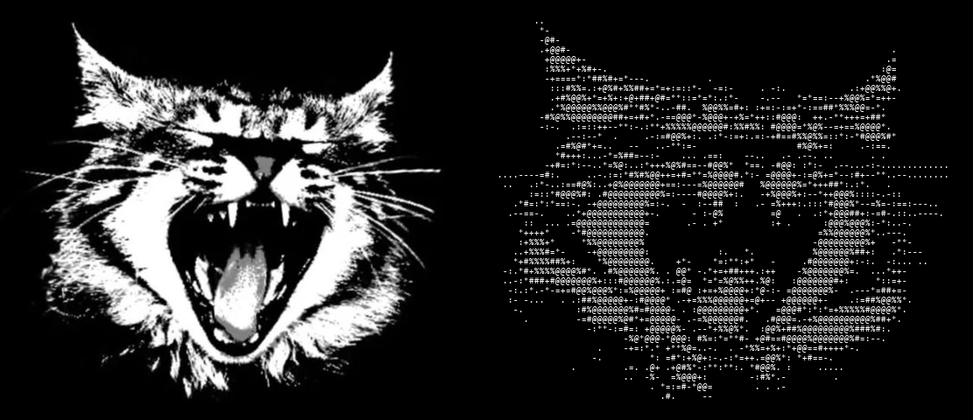

[Guide](ascii-static/GUIDE.md)

---

## 2. ascii-3d

Turns the same photo into 3D and animates it as ASCII. The steps, in the order they were built:

**1. Depth estimation.** Depth Anything V2 predicts how near each pixel is. The subject is cut out from the background and given a rounded depth.
Shown left to right: photo, model output, subject mask, final depth.

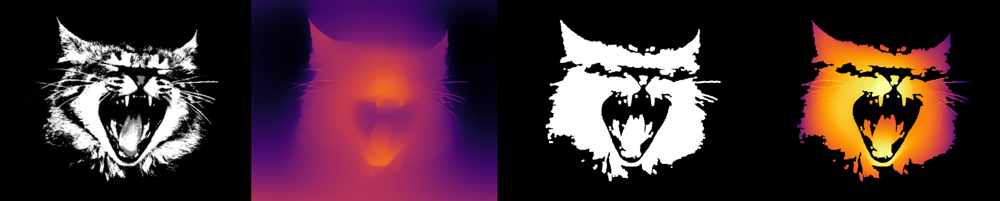

**2. Point cloud.** Every pixel is back-projected into 3D through a pinhole camera model, then the points are rotated and projected again. Shown at −30°, 0° and 30°.

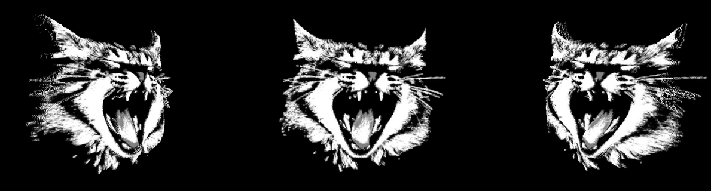

**3. Triangle mesh.** Neighbouring pixels are joined into triangles; triangles across depth jumps are dropped. Shown from the front and turned 30°.

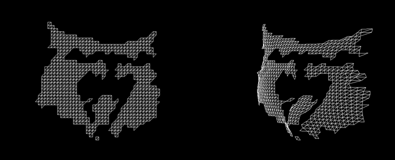

**4. Normals and lighting.** Surface normals come from cross products of neighbouring points, and Lambert's cosine law turns them into shading. Shown: normals as colours, then the shaded surface turned both ways.

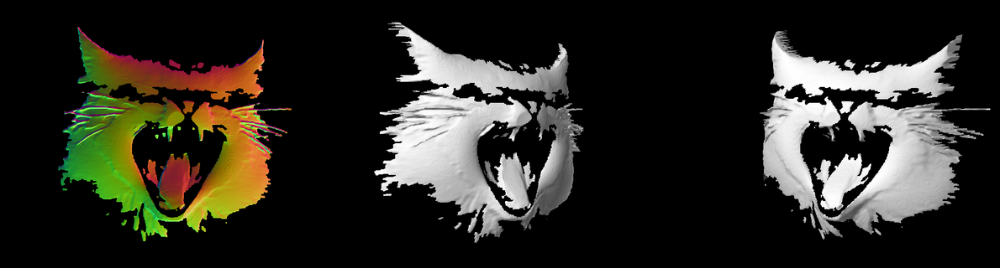

**5. Rasterizing.** A triangle rasterizer written in NumPy, with barycentric coordinates, perspective-correct interpolation and a Z-buffer, renders the lit, coloured surface.

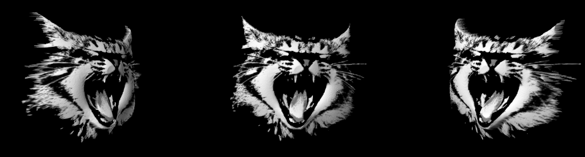

**6. Hybrid.** Hidden-line removal hides the edges behind the surface, and the visible edges are drawn on top of it.

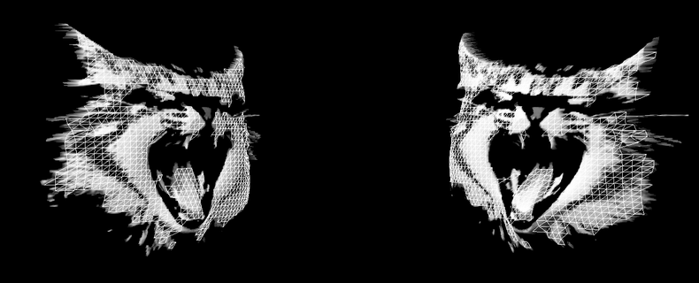

**7. ASCII.** Each render is converted to characters, using the same measured character ramp and contrast stretch as ascii-static.

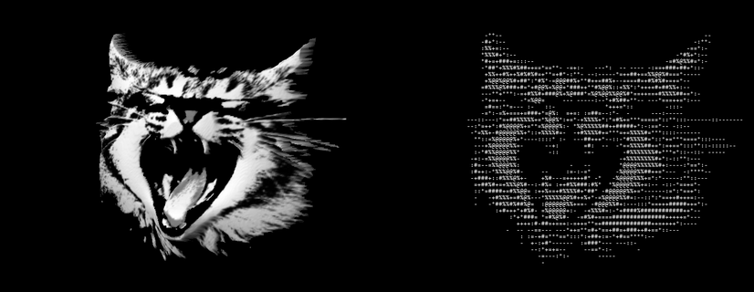

**8. Animation window.** `python ascii-3d/src/main.py` opens a window where the subject swings slowly from side to side.

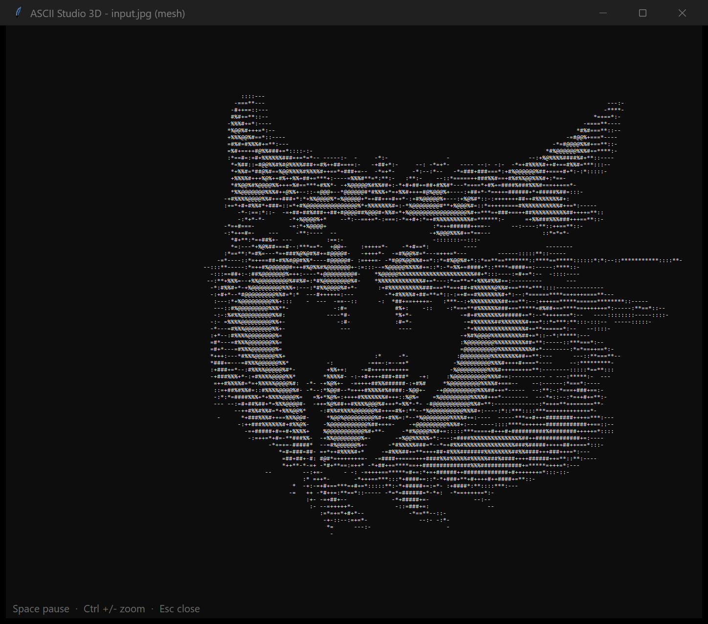

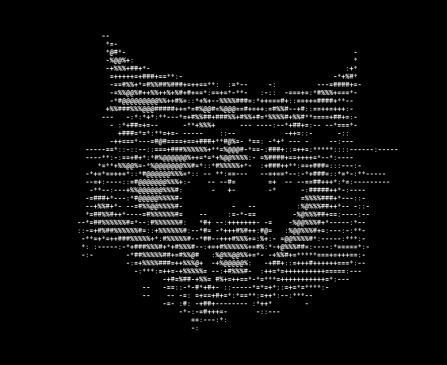

**9. Generative 3D (TripoSR).** An AI model generates a complete closed mesh, including the back the photo never showed, so it can turn all the way round. Shown: front, turned 60°, and its wireframe.

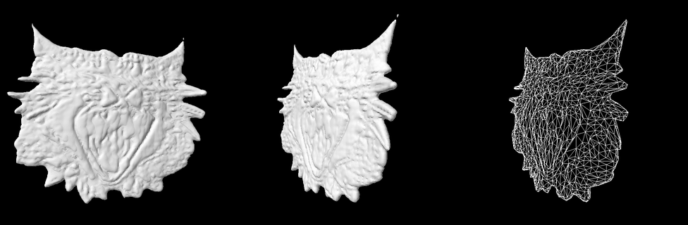

```bash
cd ascii-3d
python src/main.py                    # animation window
python src/main.py --render all       # save every render mode
python src/main.py --source triposr   # AI-generated mesh (setup in the guide)
```

[Guide](ascii-3d/GUIDE.md)

---

## 3. In progress

---

## License

[MIT](LICENSE)
