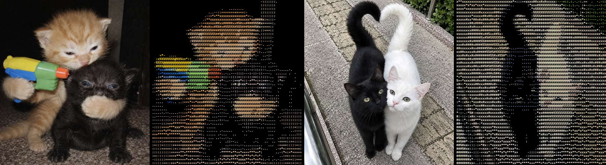
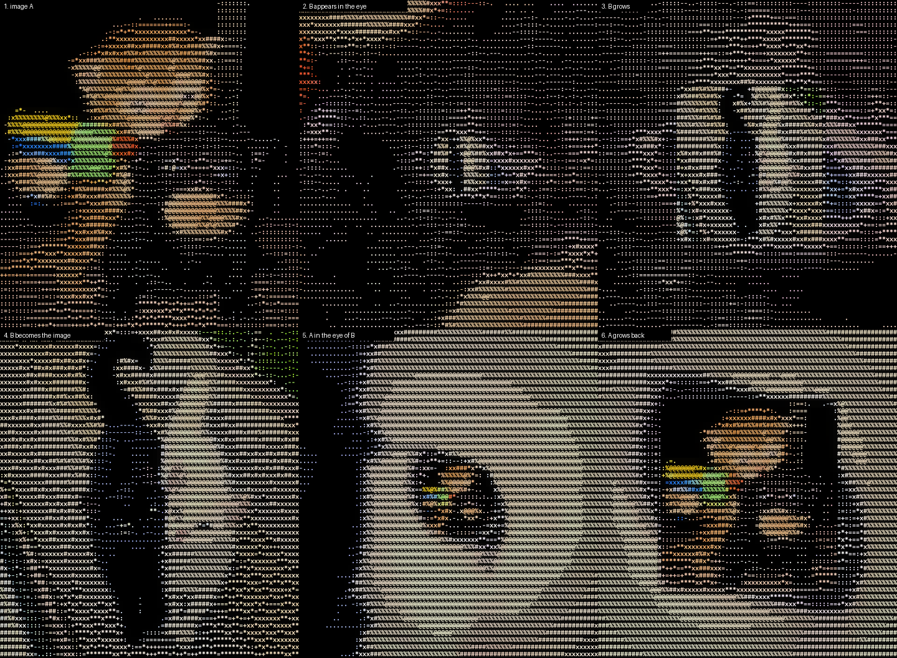
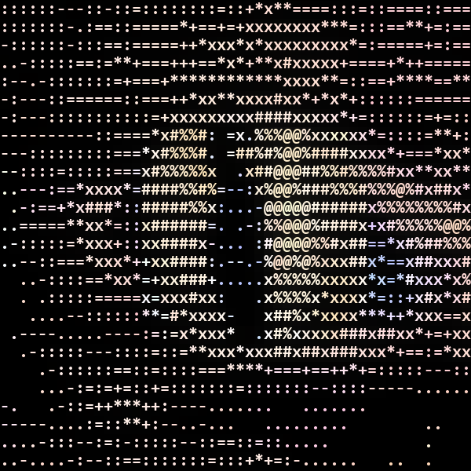
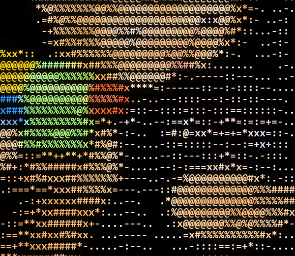

# ascii-cinema

A full-colour ASCII animation that zooms forever: into the eye in one photo,
where the second photo is waiting in the pupil, growing until it *is* the
picture, then into its eye, where the first photo is waiting, and so on, with
no visible seam.





Nothing is generated, and nothing fades in or out. The two real images are
nested inside each other's pupils (B in A, A in that B, ...), and the camera
just keeps zooming in at a constant speed. Each picture in a pupil starts a few
characters wide, grows, and fills the frame exactly as the next one appears in
its eye.



Up close, every symbol is a bold character drawn in the photo's own colour:



## Setup

From the repository root, in the shared virtual environment:

```bash
pip install -r ascii-cinema/requirements.txt
```

Images go in `ascii-cinema/assets/`, and they can have any size and aspect
ratio. Two pairs are set up in `config.py`:

| Pair | Images | Diving into |
| --- | --- | --- |
| `kittens` | `input1.jpg`, `input2.jpg` | the black kitten's eye, the white cat's eye |
| `monster` | `input3.jpg`, `input4.jpg` | the sunglasses lens, the cat's eye |

## Running

```bash
python ascii-cinema/src/main.py                      # preview in a window (Space pause, R restart, Esc quit)
python ascii-cinema/src/main.py --pair monster       # the other pair
python ascii-cinema/src/main.py --terminal           # preview in the terminal, 24-bit colour
python ascii-cinema/src/main.py --export mp4         # output/ascii_cinema_<pair>.mp4 (PAIR in config.py)
python ascii-cinema/src/main.py --pair monster --export mp4   # output/ascii_cinema_monster.mp4
python ascii-cinema/src/main.py --still 7            # one frame as a PNG, for tuning
```

`--pair`, `--loops N`, `--fps`, `--speed`, `--columns` and `--font-size` work
with every mode. Run with `--help` for the full list.

MP4 is the better format for this animation: about 12 MB for a full loop at
the default size. GIF has to compress lots of fine coloured glyphs, so it grows
quickly (around 100 MB at the default size; use something like `--columns 72
--font-size 8 --fps 20` to get it near 10 MB).

## Configuration

Everything is in [src/config.py](src/config.py):

| Setting | What it does |
| --- | --- |
| `PAIRS`, `PAIR` | the image pairs (path, focus point and `end_zoom` per image, frame aspect per pair) and the default one |
| `ZOOM_SPEED` | average doublings of magnification per second, the same for both images |
| `ZOOM_BREATH` | how much the zoom lingers on each image and surges through the dive (it never stops) |
| `NEST_SOFTNESS` | how soft the edge of the picture in the pupil is while it's small |
| `FIT` | how images are fitted to the frame (crop or letterbox) |
| `COLUMNS`, `FONT_SIZE`, `FONT_BOLD`, `CHARSET` | grid size, character size and weight, and which characters (fewer, bigger, bolder = easier to read) |
| `COLOR_BOOST`, `BACKGROUND_GLOW`, `EXPOSURE_ADAPT` | glyph colour and brightness |
| `SATURATION`, `CONTRAST`, `SPLIT_TONE` | colour grade: vivid colours, deeper darks, warm highlights and cool shadows |
| `VIGNETTE`, `BLOOM` | darker edges, and a soft glow around bright characters |

Focus points are normalized `(x, y)` in the original image: `(0, 0)` top-left,
`(1, 1)` bottom-right. Pixel `(417, 386)` in a 735 x 762 image is `(0.567,
0.507)`. To try a value without editing the file:

```bash
python ascii-cinema/src/main.py --still 7 --focus-a 0.56,0.50
```

The other image sits in the pupil at `1 / end_zoom` of the frame width, so a
larger `end_zoom` puts a smaller picture in the eye. Roughly *frame width / eye
width* makes it fit inside the eye.

To add your own pair, put the images in `assets/` and add an entry to `PAIRS`
with a focus point and `end_zoom` for each image and an `aspect` close to their
shapes. Then run it with `--pair <name>`, or set `PAIR` to make it the default.

## Code

| File | Responsibility |
| --- | --- |
| [config.py](src/config.py) | all settings |
| [images.py](src/images.py) | load, fit to the frame aspect, convert focus points, mip pyramid |
| [camera.py](src/camera.py) | `Camera2D` (zoom, pan, look-at) and sub-pixel sampling |
| [timeline.py](src/timeline.py) | easing functions and keyframe tracks (log-space zoom) |
| [ascii_color.py](src/ascii_color.py) | glyph atlas, brightness to character, colour frames, ANSI |
| [transition.py](src/transition.py) | the mask of a picture inside a pupil, as a function of its size |
| [sequence.py](src/sequence.py) | the nested images and the zoom through them |
| [effects.py](src/effects.py) | colour grade, vignette and bloom on the character grid |
| [output.py](src/output.py) | window and terminal preview, streaming GIF/MP4 export |
| [main.py](src/main.py) | command line |

[docs/LEARNING_GUIDE.md](docs/LEARNING_GUIDE.md) walks through the ideas in
the order they matter, with the lines to read.

## Tests

```bash
python -m pytest ascii-cinema/tests
```

These cover easing, keyframes, the camera, sampling, image fitting and colour
conversion. They also run the whole sequence on two synthetic images of
different shapes. They check that the zoom never stops, and that there
is no jump between images or at the loop boundary.
